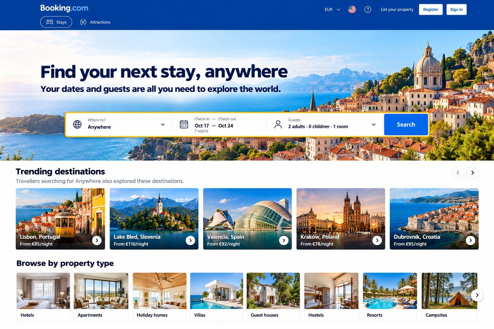
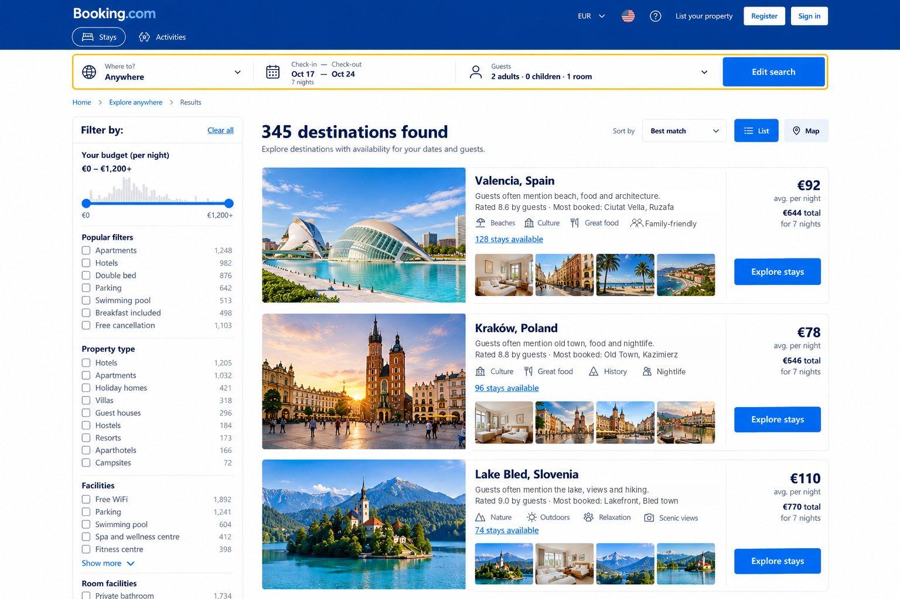
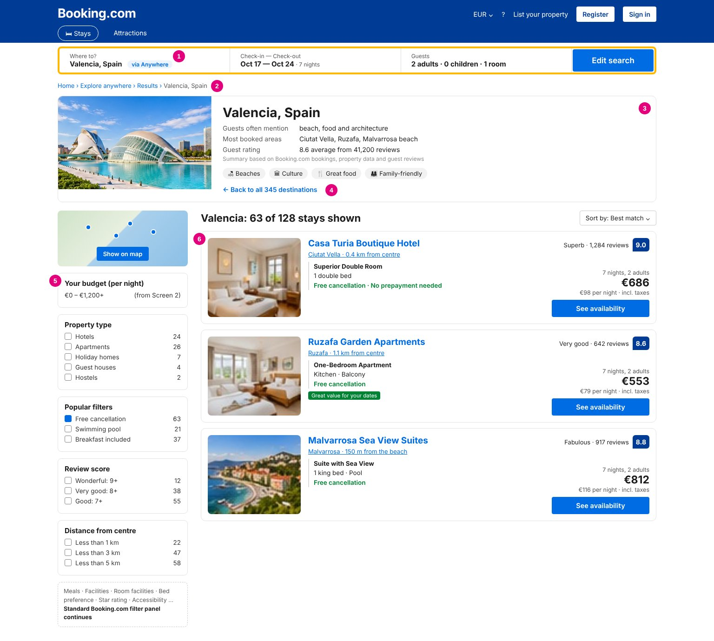

*Yuliya Fokina*

# BOOKING.COM – Functional requirements

**“Anywhere” date-led destination discovery**

> Learning exercise for the STRV Product Academy. Booking.com is the example product; system details and numbers are assumptions.

## 1. What we are building

“Anywhere” lets a traveller search with only **dates and guests**, see **destinations where suitable stays are available**, and book through the **existing booking flow**. The MVP has three screens: (1) “Anywhere” in the search box, (2) a list of destinations, (3) stays in one destination.

### In scope

- Desktop.
- The three screens below.
- Released to all users at once.
- Analytics events (section 8).

### Out of scope

- Flexible dates (fixed check-in and check-out only).
- Personalised recommendations, saved lists, flights.
- Mobile web and apps.
- Changes to the property page or checkout.
- Written destination descriptions; new filters on Screen 3.

## 2. User stories

| ID | As a traveller, I want to… | Persona |
|---|---|---|
| US-1 | search without choosing a place, so I can see where I could go | Yuliya, Tomáš |
| US-2 | see the price per night and the total for my stay, so I only consider places I can afford | Yuliya, Lucie |
| US-3 | see only places and stays that fit my whole group | Lucie |
| US-4 | get a quick, factual sense of an unfamiliar place | Tomáš, Maya |
| US-5 | compare destinations and go back without losing my filters | All |
| US-6 | book through the normal Booking.com flow | All |

## 3. Screen 1: search with “Anywhere”

*Screen 1: “Anywhere” in the destination field.*

| ID | Requirement | How we check it |
|---|---|---|
| FR-1.1 | “Anywhere” is the first option in the destination field when the field is empty. | Click into the empty field → “Anywhere” is first. |
| FR-1.2 | An Anywhere search needs fixed check-in and check-out dates, at least 1 adult and 1 room. Existing date and guest rules apply. | Search without dates → the date picker opens; no results are loaded. |
| FR-1.3 | Search opens Screen 2. All inputs are in the URL. | Refresh, back or a shared link shows the same results. |

## 4. Screen 2: destination results

*Screen 2: destinations with stays for 17–24 Oct, 2 adults.*

| ID | Requirement | How we check it |
|---|---|---|
| FR-2.1 | Show every destination with **at least 1 available stay** (R-1) for the exact dates and the whole group. | 2 adults + 2 children → no destination without stays for 4 people. |
| FR-2.2 | Each card shows: photo, name and country, short data summary (R-4), up to 4 tags (R-5), “{n} stays available”, average price per night, total price for the stay (R-2), and “Explore stays”. | Total = average per night × number of nights. |
| FR-2.3 | Sorting: Best match (default, R-3), Lowest price, Most stays. | “Lowest price” → cheapest destination first. |
| FR-2.4 | Filters: budget per night, property type, popular filters (e.g. free cancellation, pool). The list and the URL update without a page reload. | Budget max €80 → stay counts include only stays up to €80 per night. |
| FR-2.5 | 20 destinations are shown; “Show more” loads the next 20. | After “Show more”, 40 cards; scroll position kept. |
| FR-2.6 | *(Should)* A map view shows each destination as a pin with its price. | Clicking a pin opens the same destination as its card. |
| FR-2.7 | Clicking a card opens Screen 3 with the same dates, guests and filters, and the tag `src=anywhere`. | Screen 3 opens with filters already applied. |

## 5. Screen 3: explore stays

*Screen 3: numbers 1–6 match the requirements below.*

Screen 3 is Booking.com’s **existing search results page** for one destination, with three additions: the “via Anywhere” tag (1), the destination overview (3) and the “Back to all destinations” link (4).

| ID | Requirement | How we check it |
|---|---|---|
| FR-3.1 | [1] The search bar shows the destination with a **“via Anywhere”** tag. Changing dates or guests reloads the same destination. Choosing another city opens the normal search, without the tag. | Change guests to 4 → same destination, tag still shown. |
| FR-3.2 | [2] Breadcrumb: Home › Explore anywhere › Results › {Destination}. | “Results” opens Screen 2 with the same filters. |
| FR-3.3 | [3] Destination overview: photo, name, a summary of up to 3 lines (guests often mention · most booked areas · guest rating, R-4), up to 4 tags (R-5) and the line “Summary based on Booking.com bookings, property data and guest reviews”. A line without enough data is hidden. | Fewer than 50 reviews → “Guests often mention” and “Guest rating” are hidden. |
| FR-3.4 | [4] “Back to all destinations” returns to Screen 2 with the same filters and scroll position. | Scroll to card 30, open, go back → still at card 30. |
| FR-3.5 | [5] Booking.com’s **standard filter panel, unchanged**. Filters chosen on Screen 2 are already applied. | Budget €150 + Apartments on Screen 2 → both pre-selected; all standard filters available. |
| FR-3.6 | [6] Existing property cards, only for stays that fit the whole group, with the **total price for the stay**. “See availability” opens the existing property page; `src=anywhere` is kept until booking (R-6). | A booking made this way is recorded with source “anywhere”. |

## 6. Business rules

| ID | Rule |
|---|---|
| R-1 | **Available stay:** a property with at least one room offer that can be booked for the exact dates and fits all guests. |
| R-2 | **Destination price:** for each available stay, take its cheapest offer for the whole stay (incl. taxes). **Total** = the average of these. **Per night** = total ÷ number of nights. |
| R-3 | **Best match:** a simple score from availability (more stays), price (cheaper) and popularity, weighted 40 / 30 / 30 and adjustable. No personalisation. |
| R-4 | **Destination summary, from existing data only:** guests often mention = top 3 topics in reviews (min. 50 reviews); most booked areas = top 3 districts by bookings; guest rating = average score (min. 50 reviews). Fixed sentence templates, no written or AI-generated text. Updated every night. |
| R-5 | **Tags:** shown when a simple rule is met, e.g. Beaches (≥ 20% of stays near a beach), Great food (food mentioned in ≥ 15% of reviews), Family-friendly (≥ 25% of stays with family rooms). Max 4, for display only (not filters). No weather tags. |
| R-6 | **Attribution:** `src=anywhere` is carried from Screen 2 to the booking, and the booking is saved with source “anywhere”. |

## 7. Empty and error states

All messages appear **inside the results area, in place of the list**. There are no pop-ups. The search bar and filters stay visible, and **nothing the user selected is cleared automatically**.

| Situation | What the user sees | What the user can do |
|---|---|---|
| Loading | 3 placeholder cards. | Wait. |
| Filters remove all destinations | “No destinations match your filters”, with the selected filters listed, each with its own × to remove it. | Remove one filter at a time by clicking its ×. |
| No availability for the dates | “No destinations have availability for these dates and guests.” | “Edit dates” opens the date picker in the search bar, with the current dates filled in. |
| Results fail to load | “We couldn’t load destinations right now.” | “Try again” reloads with the same inputs. |
| Screen 3: filters remove all stays | “No stays match your filters”, with the selected filters listed, each with its own ×. | Remove one filter at a time. |
| Destination sold out since Screen 2 | A notice at the top of Screen 3: “Stays in {Destination} just sold out for these dates.” | “Back to all destinations” opens Screen 2 with the same filters. |

## 8. Analytics and launch

| Event | When it fires |
|---|---|
| `anywhere_selected` | User chooses “Anywhere”. |
| `anywhere_search_submitted` | A valid Anywhere search is sent. |
| `destination_results_viewed` | Screen 2 is shown. |
| `explore_stays_clicked` | User opens a destination (Screen 3). |
| `property_opened` | User clicks “See availability”. |
| `booking_completed` / `booking_cancelled` | Existing events, now with the source “anywhere”. |

Every event includes the user and the session.

**Launch:** released to all users at once.

**Main metric:** completed (not cancelled) bookings that came through “Anywhere” (source “anywhere”), per week. **Before/after check:** total bookings and search-to-booking conversion in the 4 weeks after launch vs. the 4 weeks before (and the same period last year, to account for season). **Guardrails:** conversion of normal searches, cancellation rate.

## 9. Open questions

- Should “Anywhere” be pre-selected in the search box, or only offered as the first option?
- Does Booking.com already group review text by topic in every language (needed for R-4 and R-5)?
- Can the availability system check ~350 destinations at once, or do we need to pre-calculate popular dates?
