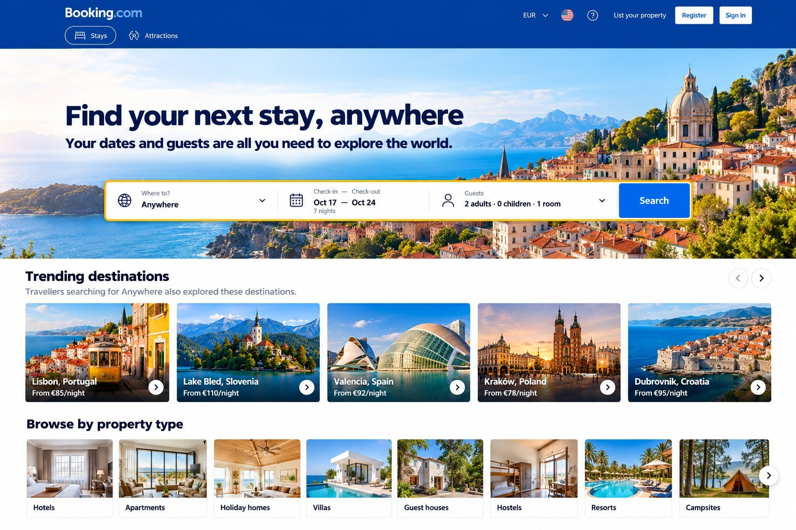
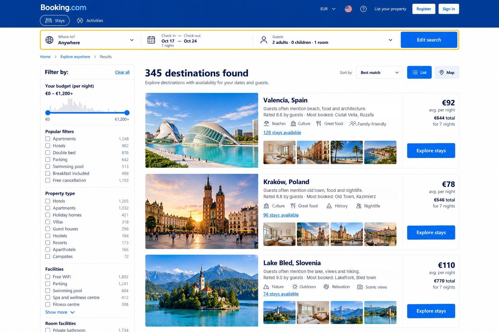
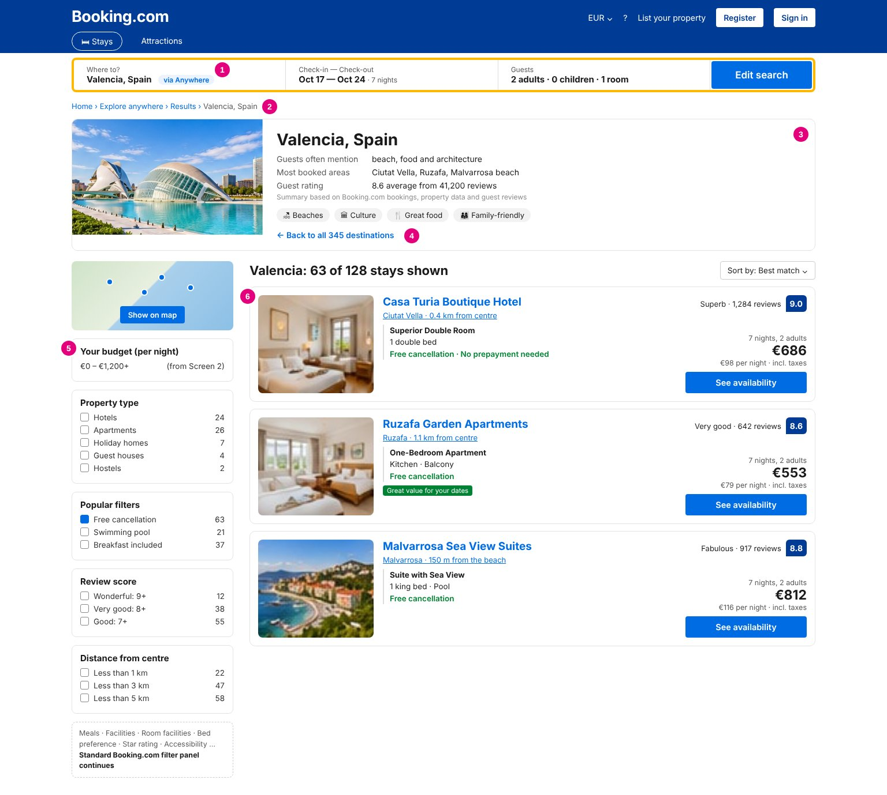

# 02 · Booking.com "Anywhere": design, prototype & functional requirements

**STRV Product Academy · Homework 2 · Design: Strategy, AI Prototyping & Bulletproof Specs**

Builds on [01 · Feature proposal](../01-feature-proposal-booking-anywhere/): a travel search that starts with *when* and *who* and helps people discover *where*.

| Deliverable | Where |
|---|---|
| 1. Moodboards (3) + design brief | [1-moodboard/brief.md](1-moodboard/brief.md) |
| 2. Clickable prototype of 3 flows, built with AI | **[Open the prototype](https://yufokina.github.io/product-manager-portfolio/02-design-prototype-booking-anywhere/2-prototype)** · [details](2-prototype/) |
| 3. Functional requirements doc (FRD) | [PDF](3-requirements/frd.pdf) · [read on GitHub](3-requirements/frd.md) |
| AI first draft vs. my edits | [3-requirements/edits-log.md](3-requirements/edits-log.md) |

---

## The 3 flows

| 1. Search "Anywhere" | 2. Pick a destination | 3. Explore stays → book |
|---|---|---|
|  |  |  |

*Concept screens. The [prototype](https://yufokina.github.io/product-manager-portfolio/02-design-prototype-booking-anywhere/2-prototype/) makes these flows clickable.*

## FRD highlights

- **Short and testable:** 6 pages; every requirement has an ID and a one-line "how we check it".
- **Clear business rules:** what an "available stay" is, how the destination price is calculated, how "Best match" ranks destinations, and how summaries and tags are built from existing data.
- **Empty and error states:** loading, no results, filters too strict, load failure, "just sold out". No pop-ups, and nothing the user selected is cleared automatically.
- **Measurable from day one:** analytics events and a main metric (bookings that came through "Anywhere").

## Key decisions & trade-offs

- **Evolve the design system, don't redesign it.** A redesign would change two things at once and make it impossible to tell what caused any change in bookings.
- **Fixed dates only in the MVP.** Flexible dates were the first cut in the budget scenario.
- **Screen 3 reuses the existing search results page** with three additions (the "via Anywhere" tag, a destination overview, a "back to all destinations" link). Its filter panel is Booking.com's standard one, unchanged.
- **Destination information comes only from existing data.** Booking.com has no written content about cities, and writing it for ~350 destinations in every language would cost more than the interface. The overview shows a factual summary (what guests mention in reviews, most booked areas, guest rating) and rule-based tags, for display only.
- **Released to all users, desktop first.** In homework 1 I planned an A/B test; here I chose a launch for everyone to save development work. The trade-off: we measure bookings through "Anywhere" and a before/after check, but can't prove the bookings are incremental.

## What I learned

- [add 2–3 points: what the AI did well, where it was wrong or vague, what I'd do differently]
