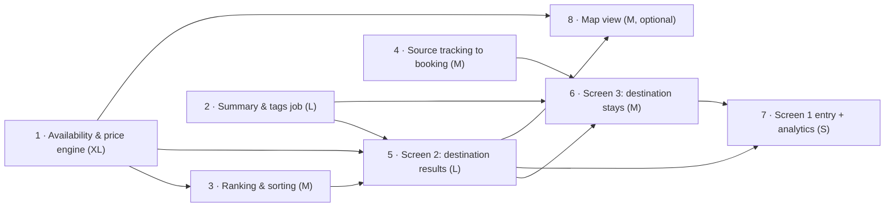

# Roadmap: "Anywhere" MVP

**Task:** order the features with T-shirt estimates, hardest and most dependent first.

Based on the [functional requirements](../../02-design-prototype-booking-anywhere/3-requirements/frd.pdf) from homework 2. Requirement IDs (FR-…, R-…) refer to that document.

## Sizes used

Sizes are relative, for one cross-functional team. They include uncertainty, not only the amount of work.

| Size | Meaning |
|---|---|
| XS | A few days. Small change to something that already exists. |
| S | About a week. Clear work, no unknowns. |
| M | 2–3 weeks. Several parts, but we know how to build them. |
| L | 4–6 weeks. A lot of work or one important unknown. |
| XL | 6+ weeks. New system or big technical risk; may need a spike first. |

## Roadmap

| Order | Feature | Size | Depends on | Why it's here in the order |
|---|---|---|---|---|
| 1 | **Destination availability & price engine**: check ~350 destinations at once for the exact dates and group, count available stays and calculate the average and total price (R-1, R-2) | **XL** | Existing availability and pricing systems | The hardest and riskiest part, and almost everything else needs its data. If it can't be made fast enough, the feature must change, so we want to know first. |
| 2 | **Destination summary & tags job**: nightly job that builds "guests often mention", "most booked areas", guest rating and rule-based tags from existing data (R-4, R-5) | **L** | Review, booking and property data | Second biggest unknown: does Booking already group reviews by topic in every language? Independent of #1, so it can run in parallel. |
| 3 | **Destination ranking & sorting**: default "Top picks…" ranking and Booking.com sort options for destinations (R-3, FR-2.3) | **M** | 1 | Needs the stays and prices from #1. Without it, the results list has no order. |
| 4 | **Source tracking to booking**: carry `src=anywhere` from Screen 2 to the booking and save it on the booking record (R-6) | **M** | Checkout / booking team | Small code, but it touches another team's booking flow. Start early so it's ready at launch; without it we can't measure the main metric. |
| 5 | **Destination results page (Screen 2)**: destination cards, filters, "Show more", empty and error states (FR-2.1–2.7, section 7) | **L** | 1, 2, 3 | The main new screen. Can be built against test data while 1–3 are in progress, but can only be finished once they work. |
| 6 | **Destination stays page (Screen 3)**: reuse the existing results page, add "via Anywhere" tag, destination overview and "Back to all destinations" (FR-3.1–3.6) | **M** | 2, 4, 5 | Mostly reuse of an existing page, so medium. Needs the summary (#2), tracking (#4) and the way in from Screen 2 (#5). |
| 7 | **"Anywhere" entry in search (Screen 1)** and **analytics events** (FR-1.1–1.3, section 8) | **S** | 5, 6 | Easy, but it's the door to the feature. We open it last, so users never reach a half-built flow. |
| 8 | **Map view** (FR-2.6, *Should*) | **M** | 1, 5 | Nice to have. Last, and the first thing to cut if time runs out. |

## Dependencies

## Why this order

The **availability and price engine** goes first because it is the hardest and riskiest piece, and the results page, ranking and map all depend on it. The **summary job** and **source tracking** start early too: the first has an open question about review data, and the second depends on another team. Both can run in parallel with the engine. The **screens** come next, built on top of the data. The **"Anywhere" entry point** is small and goes last on purpose: it's the switch that shows the feature to users. The **map** is optional and is the first cut if the timeline slips.

**Before launch:** record 4 weeks of normal bookings and conversion as the baseline for the before/after check (FRD section 8). This uses existing data and needs no development.
